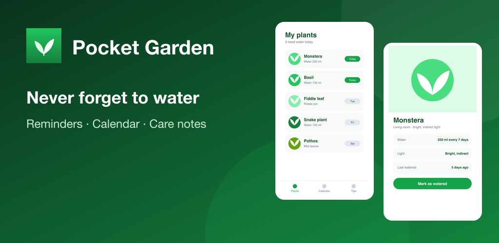

# ShipFast

Ship any mobile app to Google Play and the App Store fast, with a coding agent.

```text
/shipfast launch Android app on Play Store
/shipfast launch ios
```

ShipFast is an agent skill ([`.claude/skills/shipfast`](.claude/skills/shipfast/SKILL.md)) for Flutter, Expo, React Native, Capacitor, native Android and native iOS apps. The agent:

- detects the app, builds and verifies the signed release;
- plans first-launch gates;
- prepares the review account;
- designs the app icon;
- turns real-device captures into every store image;
- drafts the listing text and privacy policy;
- fills declarations from code evidence;
- submits within the scope you approve.

It keeps resumable state in `.shipfast/` in your app. No external image API or key is needed.

## Install

```bash
npx skills add tangible-idea/ShipFast --skill shipfast -a claude-code       # current project
npx skills add tangible-idea/ShipFast --skill shipfast -a claude-code -g    # all your projects
npm install --prefix .claude/skills/shipfast                               # renderer dependency (sharp); ~/.claude/skills/shipfast for -g
```

See the [skill README](.claude/skills/shipfast/README.md) for usage, update/remove commands and the full list of outputs.

**Walkthrough:** [what happens when you run `/shipfast launch Android app on Play Store`](docs/use-case-android.md). It includes flow diagrams, how the screenshots, feature graphic and icon are made (with real renderer output), and how the privacy policy is built from code evidence.



### Store images it renders

| Store | Output | Size |
| --- | --- | --- |
| Both | App icon (from agent-designed SVG) | iOS 1024×1024 (no alpha), Play 512×512 |
| Google Play | Phone screenshots | 1080×1920 |
| Google Play | Feature graphic | 1024×500 |
| App Store | iPhone screenshots | 1320×2868 default (1290×2796, 1260×2736, 1284×2778, 1242×2688) |
| App Store | Product Page Header | 3840×1646 (21:9) |
| App Store | Search Results | 1920×1280 – 3840×2560 (3:2) |
| App Store | Universal (both placements) | 5244×2950 (16:9) |

## Develop

```bash
npm install
npm test
```

Tests cover the renderers in `.claude/skills/shipfast/scripts/` and the web app below.

## Companion web app (optional)

`src/` and `public/` contain Shipframe, a local web app that connects a GitHub repository and builds a basic launch kit without an agent. It finds existing store screenshots (currently tuned for Flutter repositories) and checks them for iPhone, iPad, Android phone and Android tablet. It also resizes correctly proportioned screens to store sizes, builds an icon from a theme and color with a built-in SVG logo, drafts a privacy policy, and exports everything as a ZIP.

```bash
cp .env.example .env
# Fill in GITHUB_CLIENT_ID, GITHUB_CLIENT_SECRET and SESSION_SECRET
npm start
```

Open `http://localhost:4321`. Set the GitHub OAuth app's Homepage URL to `http://localhost:4321` and the Authorization callback URL to `http://localhost:4321/auth/github/callback`. The OAuth `repo` scope is requested for private repositories. The app never runs repository code on the server. For production use, switch to an HTTPS `BASE_URL`, a persistent session store, token encryption and a GitHub App with fine-grained permissions.

The interface is available in English, Japanese and Korean. The privacy draft and launch-kit README follow the selected language (`PRIVACY.en.md`, `PRIVACY.ja.md`, `PRIVACY.ko.md`). The privacy draft is not legal advice; verify SDKs, data flows and retention before publishing it.

Neither the skill's scripts nor the web app upload to or submit in Play Console or App Store Connect by themselves.
