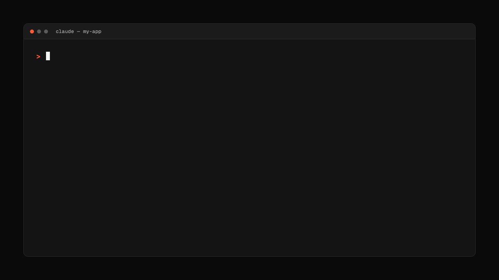
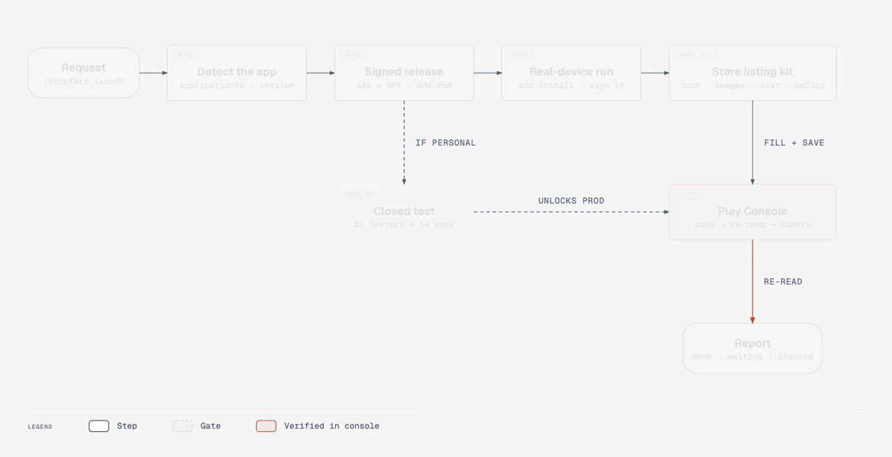
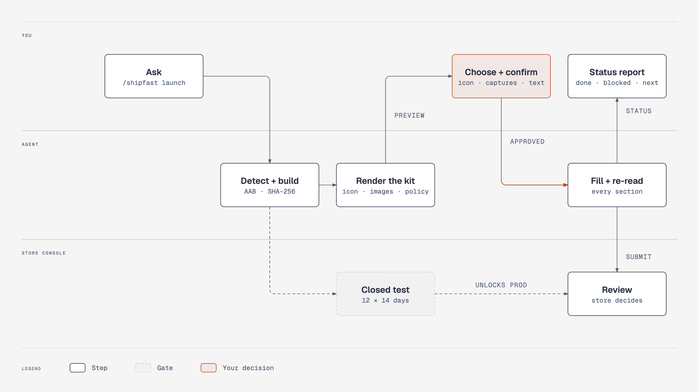
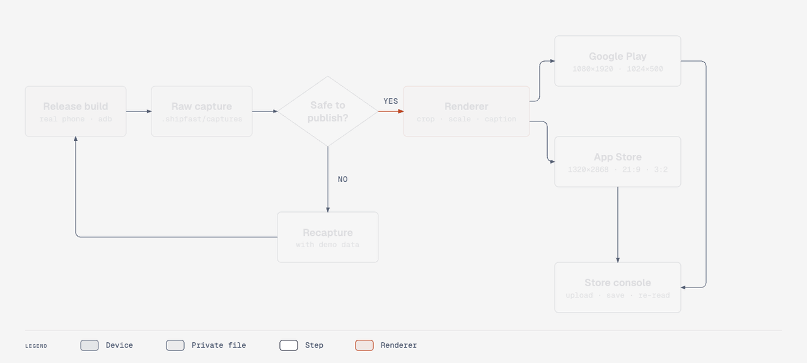
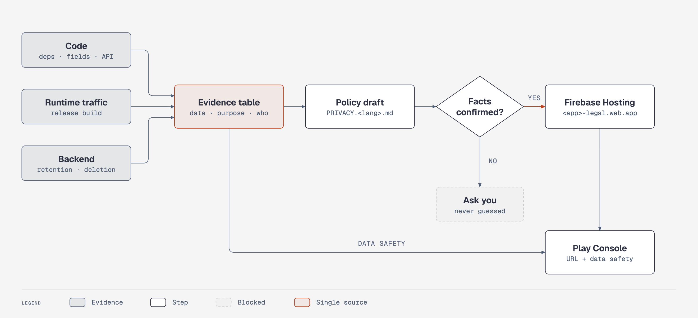
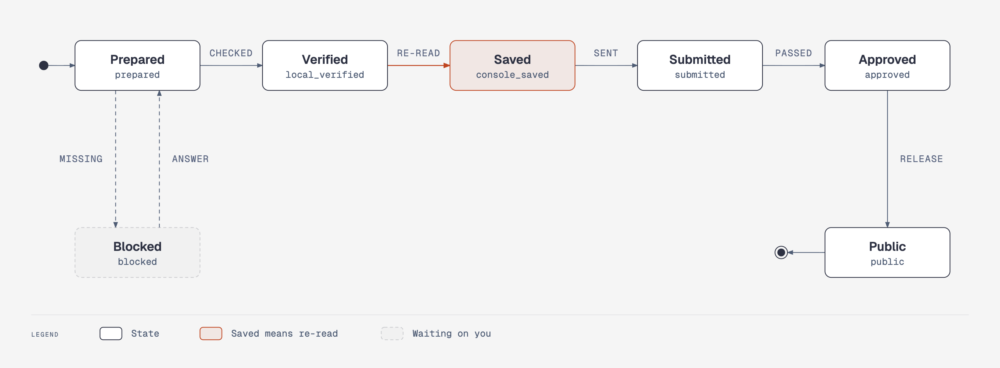

<div align="center">

<h1>ShipFast</h1>

**An agent skill that takes any mobile app from source to a Google Play and App Store submission.<br>Real-device screenshots. Every store image. Evidence-based privacy policy. No mockups.**

[](.claude/skills/shipfast/SKILL.md)
[](.claude/skills/shipfast/references/google-play.md)
[](.claude/skills/shipfast/references/app-store.md)
[](.claude/skills/shipfast/package.json)

[Install](#install) · [How it works](#how-it-works) · [Store images](#how-store-images-are-made) · [Privacy policy](#how-the-privacy-policy-is-made) · [Tracking](#every-item-is-tracked) · [Commands](#commands)

<code>npx skills add tangible-idea/ShipFast --skill shipfast</code>

<br><br>



</div>

<br>

Ask your agent in plain words:

- *"/shipfast launch Android app on Play Store"*
- *"/shipfast launch ios"*: same flow for App Store Connect
- *"/shipfast images ios"*: only the iPhone screenshots plus Product Page Header and Search Results images
- *"/shipfast icon"*: three SVG concepts on a masked comparison sheet, then iOS 1024px and Play 512px icons
- *"/shipfast resume"*: continue from what was saved in `.shipfast/`

The agent detects your stack (Flutter, Expo, React Native, Capacitor, native Android or iOS). Before anything that needs your decision, it states its plan, and it records every step in `.shipfast/` in your app. No external image API or key is needed.

---

## Install

Works with any host that reads Agent Skills, including Claude Code, Cursor, Codex and Gemini CLI:

```bash
npx skills add tangible-idea/ShipFast --skill shipfast
```

The renderers use `sharp`. Install it once inside the installed skill folder:

```bash
npm install --prefix .claude/skills/shipfast        # project install
npm install --prefix ~/.claude/skills/shipfast      # global install (-g)
```

<details>
<summary><b>Claude Code</b>: project vs. global</summary>

```bash
npx skills add tangible-idea/ShipFast --skill shipfast -a claude-code       # ./.claude/skills/shipfast
npx skills add tangible-idea/ShipFast --skill shipfast -a claude-code -g    # ~/.claude/skills/shipfast
```

Invoke it with `/shipfast …` or just describe what you want ("publish my app to the Play Store").

</details>

<details>
<summary><b>Every agent at once</b></summary>

```bash
npx skills add tangible-idea/ShipFast --skill shipfast -a '*' -y
```

</details>

<details>
<summary><b>Update or remove</b></summary>

```bash
npx skills check
npx skills update shipfast
npx skills remove shipfast          # add -g for a global install
```

Run `npm install --prefix <skill folder>` again after an update if `package.json` changed.

</details>

---

## How it works

<picture>
  <source media="(prefers-color-scheme: dark)" srcset="docs/assets/launch-flow-dark.gif">
  
</picture>

This is the whole run. Tags show who acts at each step: `AUTO` steps run without stopping, and `ASKS YOU` steps wait for your choice. Nothing counts as done until it is saved in the console and read back.

<picture>
  <source media="(prefers-color-scheme: dark)" srcset="docs/assets/who-does-what-dark.png">
  
</picture>

| You | The agent | The store |
| --- | --- | --- |
| Ask once, then choose the icon, confirm captures are safe, approve the text | Detects the app, builds and verifies the signed release, renders the kit, fills every console section and re-reads it | Runs the closed test (new personal Play accounts: 12 testers × 14 days) and the review |

The agent always asks before it creates or pays for accounts, replaces signing keys, expands countries, touches production data or picks a public release over a staged one.

---

## How store images are made

<picture>
  <source media="(prefers-color-scheme: dark)" srcset="docs/assets/store-images-dark.gif">
  
</picture>

Every image starts from your release build on a real phone. You confirm each capture shows no personal data. The renderer then crops the system bars, scales the real UI uniformly and adds a caption and frame. It never redraws or stretches the app.

| Store | Output | Size |
| --- | --- | --- |
| Both | App icon (from agent-designed SVG) | iOS 1024×1024 (no alpha), Play 512×512 (≤ 1 MiB) |
| Google Play | Phone screenshots | 1080×1920 |
| Google Play | Feature graphic | 1024×500 |
| App Store | iPhone screenshots | 1320×2868 default (also 1290×2796, 1260×2736, 1284×2778, 1242×2688) |
| App Store | Product Page Header | 3840×1646 (21:9) |
| App Store | Search Results | 1920×1280 – 3840×2560 (3:2) |
| App Store | Universal (both placements) | 5244×2950 (16:9), with crop-guide previews |

---

## How the privacy policy is made

<picture>
  <source media="(prefers-color-scheme: dark)" srcset="docs/assets/privacy-policy-dark.png">
  
</picture>

The policy comes from what the app actually does, not from a template. The agent records each data type in an evidence table: where it was found, the purpose, who receives it and how long it is kept. The draft and Play's Data safety form (or App Store App Privacy) are filled from that one table, so they always match. Facts it cannot confirm are put to you; it never guesses them. The draft is not legal advice.

ShipFast asks you to sign in with `firebase login` (it reads only the account email, never the tokens). It then proposes the contact email, operator name and Firebase project, and after you confirm them once it deploys the policy, support and account-deletion pages to a dedicated site, for example `https://<app>-legal.web.app/privacy/`. It fetches each live URL to check it before entering it in the store console. Your app's own Firebase Hosting site is never touched.

---

## Every item is tracked

<picture>
  <source media="(prefers-color-scheme: dark)" srcset="docs/assets/item-states-dark.png">
  
</picture>

Each build, image, text field and declaration moves through these states in `.shipfast/<platform>-state.json`. Run `/shipfast status` to see them. Run `/shipfast resume` to continue from the recorded `nextAction`. Secrets stay in `.shipfast/secrets/` (mode 600), and `.shipfast/` is added to your `.gitignore`.

---

## Commands

```text
/shipfast [launch|resume|status|icon|screenshots|images|listing|privacy] [android|ios|both] [app]
```

| Action | What it does |
| --- | --- |
| `launch` | The full flow above (default) |
| `resume` / `status` | Continue from, or report, the saved state |
| `icon` | Design SVG concepts and render store icons |
| `screenshots` / `images` | Capture and render store screenshots / all store graphics |
| `listing` | Draft store text within each store's limits |
| `privacy` | Build the evidence table and privacy policy draft |

<details>
<summary><b>What's inside the skill</b></summary>

| Path | Purpose |
| --- | --- |
| [`SKILL.md`](.claude/skills/shipfast/SKILL.md) | Arguments, launch flow, scope and verification rules |
| [`references/frameworks.md`](.claude/skills/shipfast/references/frameworks.md) | Stack detection and release build/verify commands |
| [`references/google-play.md`](.claude/skills/shipfast/references/google-play.md) | Play Console procedure, closed-test gate, observed failure modes |
| [`references/app-store.md`](.claude/skills/shipfast/references/app-store.md) | App Store Connect procedure, Header/Search Results specs |
| [`references/store-listing.md`](.claude/skills/shipfast/references/store-listing.md) | Text limits, required URLs, privacy policy drafting |
| [`scripts/`](.claude/skills/shipfast/scripts/) | Icon, Google Play and App Store renderers; `publish-policy.mjs` for Firebase Hosting |
| [`templates/`](.claude/skills/shipfast/templates/) | Renderer configs and release state templates |

</details>

<details>
<summary><b>Companion web app (optional)</b></summary>

`src/` and `public/` contain Shipframe, a local web app that connects a GitHub repository and builds a basic launch kit without an agent. It checks existing screenshots per device, builds an icon from a theme and color, drafts a privacy policy and exports a ZIP.

```bash
npm install && cp .env.example .env   # fill GITHUB_CLIENT_ID, GITHUB_CLIENT_SECRET, SESSION_SECRET
npm start                             # http://localhost:4321
```

Set the GitHub OAuth callback to `http://localhost:4321/auth/github/callback`. The app never runs repository code on the server.

</details>

---

## Develop

```bash
npm install
npm test                                  # renderer and web app tests
python3 docs/diagrams/build.py            # regenerate the diagram HTML
PLAYWRIGHT_CHANNEL=chrome python3 docs/diagrams/export.py   # PNG + GIF into docs/assets
```

The diagrams are drawn with [diagram-design](https://github.com/cathrynlavery/diagram-design). They pass its `self_check.py`, `verify-geometry.py` and `lint-render.py`, and the animated versions use its motion template's controller unchanged.

Neither the scripts nor the web app upload to or submit in Play Console or App Store Connect on their own; the agent does that only within the scope you approve.
