# Use case: `/shipfast launch Android app on Play Store`

This walkthrough follows one first launch from start to finish. The app is **Pocket Garden**, a plant-care demo app: a Flutter project, published from a personal Play Console account that was created recently, with no store listing yet.

> The images on this page are real output from the ShipFast renderers. The app screens they start from are synthetic stand-ins made by [`demo/make-demo-captures.mjs`](demo/make-demo-captures.mjs). In a real run, those screens come from `adb exec-out screencap` on a phone running your release build. Never submit mockups to a store.

## 1. The whole run at a glance

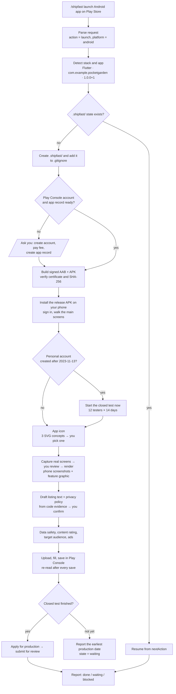

## 2. Who does what

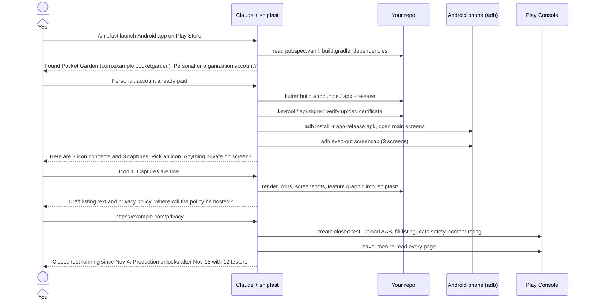

## 3. Step by step

| Step | What the agent does | What it asks you | Evidence saved |
| --- | --- | --- | --- |
| Detect | Reads the Flutter, Gradle and manifest files; finds `applicationId`, version, flavors | Which app, if the repo has several | `.shipfast/android-state.json` → `target` |
| Account | Checks the Play Console app record and account type | To create or pay for the account, if needed (never does it alone) | `target.developerAccountType` |
| Build | `flutter build appbundle --release`, `apk --release`; compares the certificate with the upload key | Keystore location, if it isn't configured | AAB size, SHA-256, certificate fingerprint |
| Run | Installs the release APK on your phone and signs in | Test account password (kept in `.shipfast/secrets/`, mode 600) | `reviewAccess.androidLoginVerifiedAt` |
| Closed test | Creates the closed track and adds testers | Tester emails or a Google Group | `closedTest.startedAt`, `optedInTesters` |
| Icon | Designs 3 SVG concepts and renders a masked comparison sheet | Which concept | `icons-manifest.json` with the source hash |
| Images | Captures, crops system bars, renders screenshots and the feature graphic | Confirm every capture is safe to publish | `assets-manifest.json` with source hashes |
| Text | Drafts the name, short description and full description within the limits | Approve or edit | `.shipfast/listing.en-US.md` |
| Privacy | Drafts the policy from dependencies and data flows | Contact email, hosting URL | `.shipfast/privacy/PRIVACY.en.md` |
| Console | Uploads, fills, saves and re-reads each section | Nothing, within the scope you gave | `console_saved` per item |
| Report | Lists what is done, what is waiting and what is blocked | - | `lastVerifiedObservation`, `nextAction` |

## 4. How the store images are made

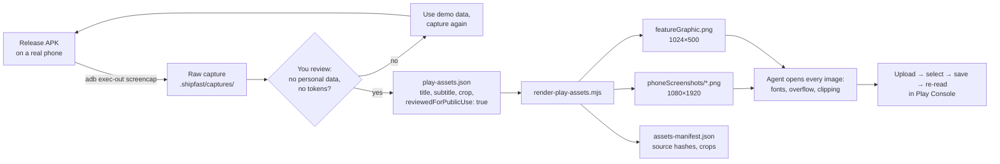

**Crop, then frame.** The renderer removes the status bar and navigation bar, scales the real UI uniformly and adds a caption. It never redraws or stretches the app.

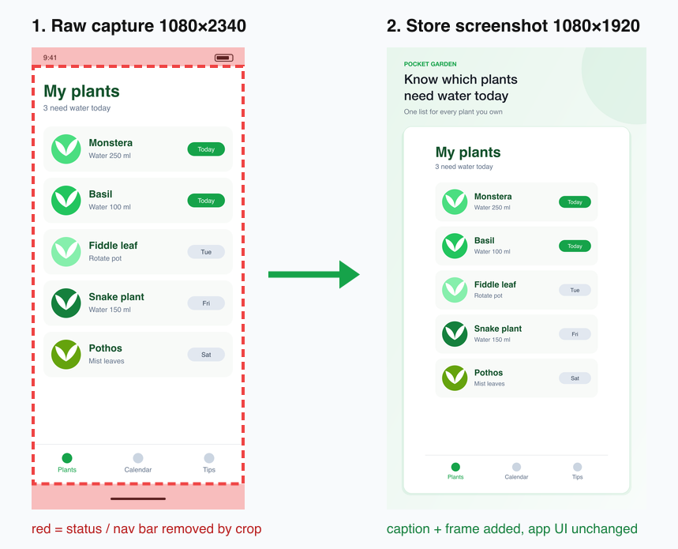

**Phone screenshots** (3 of the allowed 2–8):

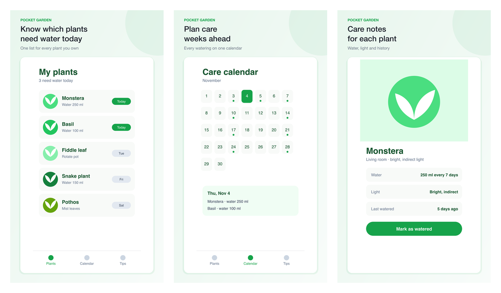

**Feature graphic** (1024×500). It shows the app icon, a headline and two of the real screens. Every color comes from `brandColor`:

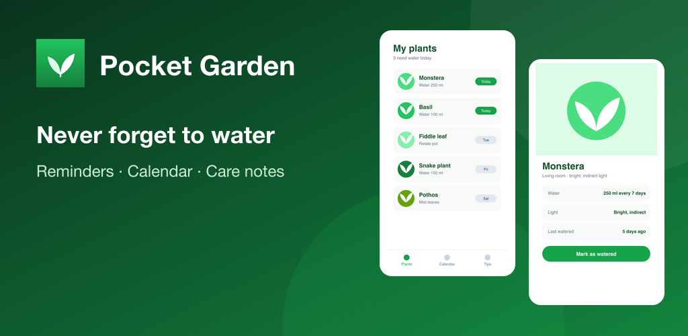

The config behind these images ([full file](demo/play-assets.json)):

```json
{
  "appName": "Pocket Garden",
  "brandColor": "#16a34a",
  "icon": "./out/icons/google-play-icon-512.png",
  "screens": [
    {
      "input": "./captures/plants.png",
      "output": "phoneScreenshots/01-plants.png",
      "title": "Know which plants\nneed water today",
      "subtitle": "One list for every plant you own",
      "crop": {"left": 0, "top": 96, "width": 1080, "height": 2114},
      "reviewedForPublicUse": true
    }
  ],
  "feature": {"screenIndices": [0, 2], "headline": "Never forget to water"}
}
```

## 5. How the app icon is made

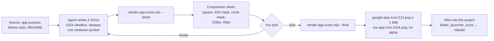

The sheet shows each concept under real store masks and at small sizes, so legibility problems show up before you choose:

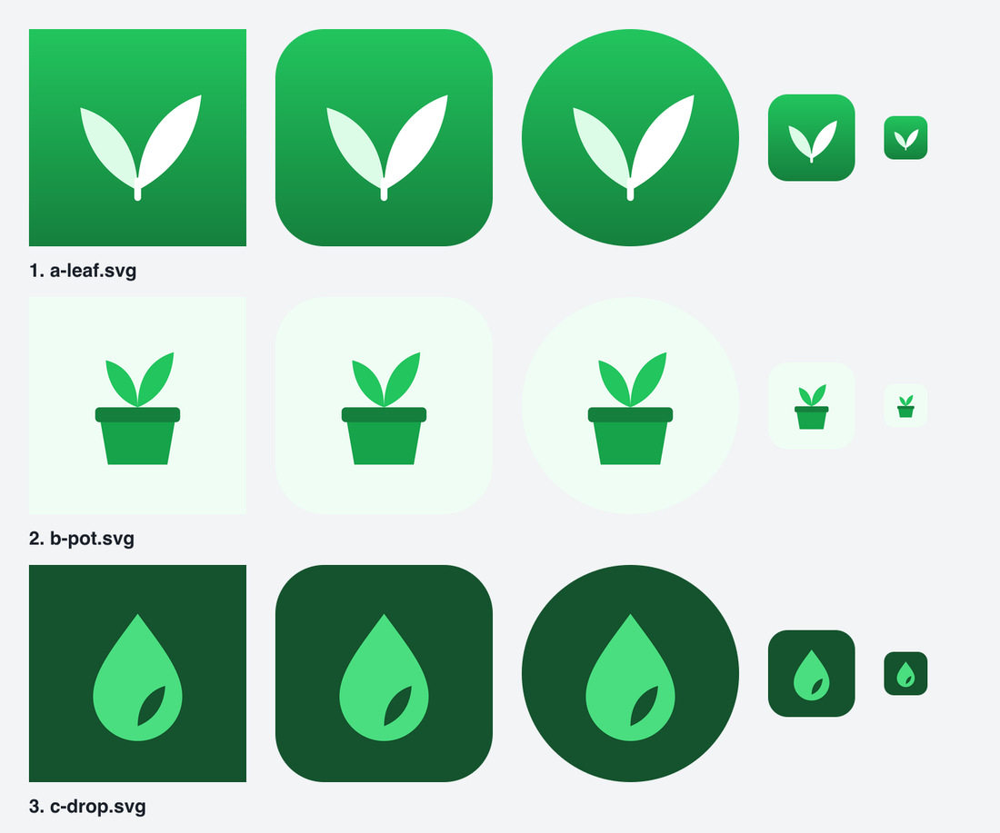

The script rejects any SVG with transparent pixels or external references, because store masks need a full-bleed opaque square.

## 6. How the privacy policy is made

The policy comes from what the app actually does, not from a template. The same evidence then fills Play's Data safety form, so the two cannot drift apart.

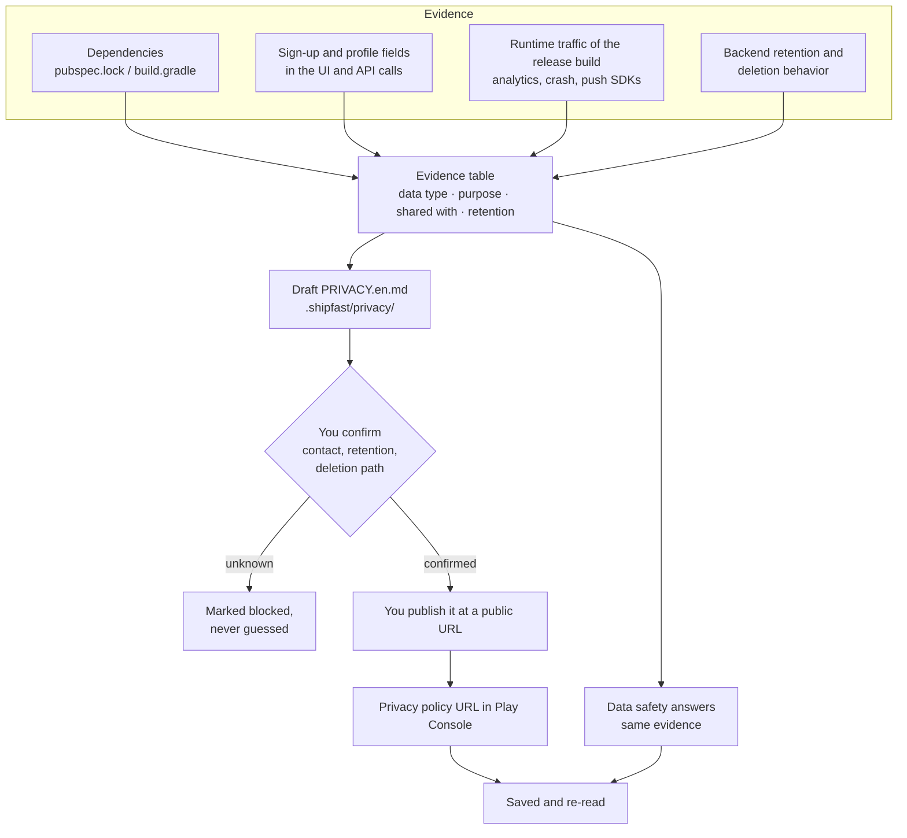

Example evidence table for Pocket Garden (illustrative):

| Data | Found in | Purpose | Shared with | Retention |
| --- | --- | --- | --- | --- |
| Email address | Sign-up screen, `POST /users` | Account | Backend host (processor) | Until account deletion |
| Plant names and notes | `POST /plants` | App functionality | Backend host (processor) | Until deleted by user |
| Crash logs, device model | `firebase_crashlytics` in `pubspec.lock`; traffic seen at runtime | Diagnostics | Google (processor) | 90 days |
| Push token | `firebase_messaging`; token registered at startup | Reminders | Google (processor) | Until sign-out |

Excerpt of the draft it produces:

```markdown
## What we collect
- **Email address**, to create and secure your account.
- **Your plants and care notes**, to show reminders and your calendar.
- **Crash reports and device model** (Firebase Crashlytics), to fix bugs.
- **A push notification token** (Firebase Cloud Messaging), to send watering reminders.

## Deleting your data
Settings → Account → Delete account removes your account and plants within 30 days.
You can also email privacy@example.com.
```

Two things the agent checks before it trusts this table. An SDK with an empty configuration can still send traffic, so the table is based on what the release build actually sends. And a deletion screen that never reaches the server is not a deletion path. The agent says the draft is not legal advice.

## 7. The closed-test gate

New personal Play Console accounts cannot publish to production until a closed test has kept 12 testers opted in for the last 14 days in a row. ShipFast starts the test as soon as a signed build exists, so preparing the listing overlaps with the wait:

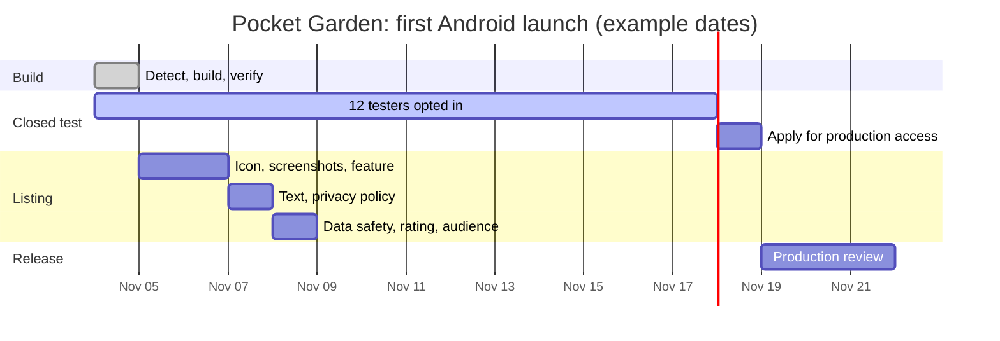

Organization accounts skip this section. The review time shown is only an example; Google decides it.

## 8. What gets tracked

Each item moves through the same states. `/shipfast status` and `/shipfast resume` read them back:

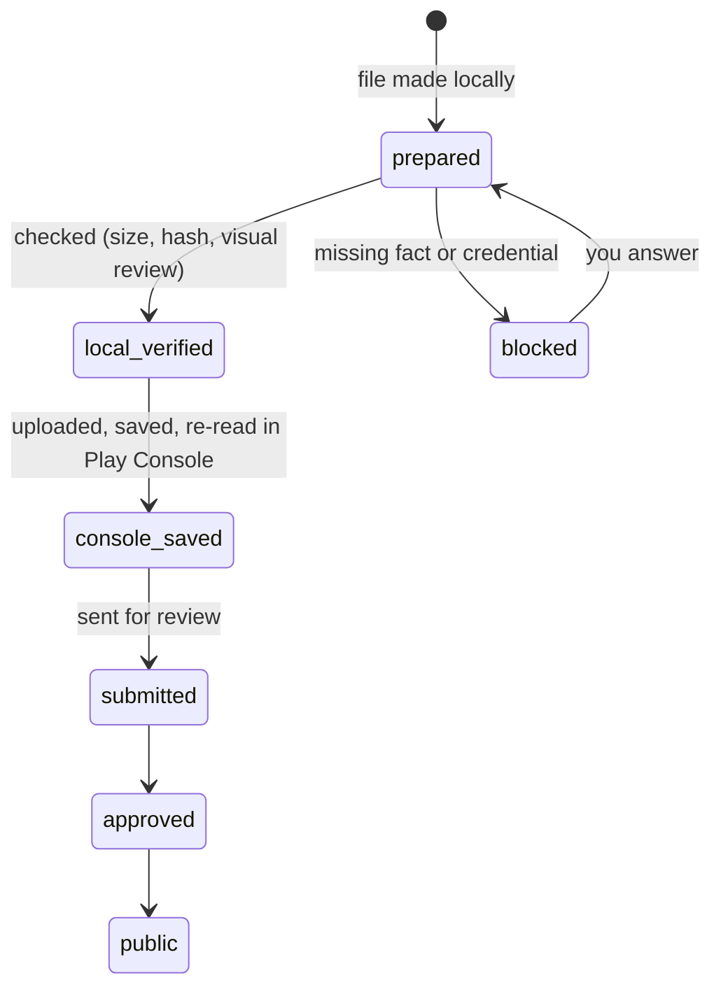

```text
pocket_garden/
└── .shipfast/                 # git-ignored
    ├── android-state.json     # every item's state, hashes, nextAction
    ├── captures/              # raw screenshots (private)
    ├── icons/                 # SVG concepts, sheet, final PNGs
    ├── play-assets.json       # renderer config
    ├── out/                   # rendered store images + manifests
    ├── listing.en-US.md
    ├── privacy/PRIVACY.en.md
    └── secrets/               # mode 600: review account, never committed
```

## What it never does on its own

- Create or pay for developer accounts, or replace signing keys.
- Submit mockups or AI-drawn UI as screenshots, or stretch phone screens for tablets.
- Guess credentials, data-handling facts or questionnaire answers, or copy them from another app.
- Report "done" when a file was only generated. Done means saved in Play Console and read back.

To reproduce the images on this page, run this from the repository root:

```sh
node docs/demo/make-demo-captures.mjs
S=.claude/skills/shipfast/scripts; cd docs/demo
node ../../$S/render-app-icons.mjs --sheet icons/*.svg --out out/icon-sheet.png
node ../../$S/render-app-icons.mjs --final icons/a-leaf.svg --out out/icons
node ../../$S/render-play-assets.mjs --config play-assets.json
```
